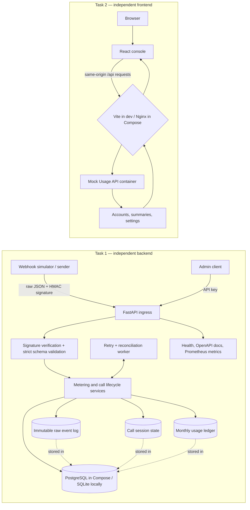

# Callzo Engineering Assessment


## System architecture

Callzo contains two independent assessment applications. They share this repository, but Task 2 does not use Task 1's API or database.

| Layer | Task 1: usage metering backend | Task 2: usage admin console |
|---|---|---|
| Entry point | FastAPI webhook and admin routes (`app/main.py`) | React single-page application (`src/App.jsx`) |
| Validation / routing | HMAC verification on raw webhook bytes; strict schemas; API-key admin auth | URL query state for search, filters, sorting, dates, pagination; API requests use `/api/*` |
| Core logic | Idempotent event processing, call lifecycle handling, integer-cent caps, retries, reconciliation (`app/services.py`) | Directory, selections, usage summaries and SVG prism, settings drawer, themes and error/loading states |
| Persistence / data | PostgreSQL in Compose; SQLite adapter locally and in tests (`app/database.py`) | Supplied mock Usage API; no shared Task 1 storage |
| Runtime support | Retry/reconciliation worker; health and Prometheus metrics | Vite proxy in development; Nginx reverse proxy in Compose |
| Tests | `pytest` against isolated SQLite test DB | No unit test runner configured; use `npm run build` to verify compilation |

### End-to-end flows



For Task 1, raw request bytes are authenticated before JSON parsing. Validated events enter transactional business logic; unique event IDs protect against duplicate delivery while call IDs reconcile lifecycle ordering. The event log is the audit source, and the monthly ledger is a derived, integer-based read model. Background work handles retries and repairs drift by comparing derived usage with raw events.

For Task 2, the browser loads the SPA from Vite or Nginx and sends requests to its own `/api` path. Vite forwards those requests to `localhost:8001` during host development; Nginx forwards to `mock-api:8001` over the Compose network. URL state is shareable; selections, theme, and in-progress settings are client state; account and usage data remain owned by the mock API.

### Runtime boundaries

```text
Task 1 Compose: simulator → FastAPI → PostgreSQL (named pgdata volume)
                           ↘ retry/reconciliation worker ↗

Task 2 Compose: browser → local frontend container (built from this source)
                         → Nginx /api proxy → mock-api container

Task 1 host development: FastAPI → SQLite file
Task 2 host development: Vite → mock API container
```

These boundaries let each task run and be evaluated independently. Docker service names are only resolvable inside their Compose network; browser code always calls the frontend origin. See the task READMEs for component maps, setup steps, API details, and test commands.

This repository contains two independent assessment projects:

- `task1-backend/`: FastAPI call usage metering API with PostgreSQL support.
- `task2-frontend/`: React account usage console with an Apple-inspired liquid glass interface.
- `Task/`: the assessment PDF and task specifications.

## Choose how to run

| Project         | Run from source                                           | Full assessment stack                           |
| --------------- | --------------------------------------------------------- | ----------------------------------------------- |
| Task 1 backend  | Python 3.12 + SQLite; no Docker required                  | Docker Compose + PostgreSQL + webhook simulator |
| Task 2 frontend | Vite source app; the supplied mock API still needs Docker | Vite source app + mock API container            |

For either Docker option, start Docker Desktop and wait until its **Linux engine** is running. If Docker reports that it cannot connect to `dockerDesktopLinuxEngine`, the Docker daemon is not running yet.

## Run Task 1 locally

### Host run: Python 3.12 + SQLite

This is the quickest way to run the API without Docker or Python 3.11. In PowerShell, start at the repository root and enter `task1-backend` once:

```powershell
cd task1-backend
py -3.12 -m venv .venv
.\.venv\Scripts\python.exe -m pip install -r requirements.txt
$env:DATABASE_URL = 'sqlite:///./callzo_metering.db'
$env:WEBHOOK_SECRET = 'callzo_test_secret_change_me'
$env:ADMIN_API_KEY = 'callzo_admin_key_2026'
.\.venv\Scripts\python.exe -m uvicorn app.main:app --reload --host 127.0.0.1 --port 8000
```

Open `http://localhost:8000/health` for the health response or `http://localhost:8000/docs` for the interactive API documentation. The API does not serve a homepage at `/`, so a `404 Not Found` at the site root is expected. This host mode uses SQLite and does not start the Docker webhook simulator. It is for local API development; use the Docker option below to exercise the PostgreSQL-backed assessment stack and simulator.

### Full stack: Docker Compose, PostgreSQL, and simulator

Start Docker Desktop first. In PowerShell, from the repository root:

```powershell
cd task1-backend
docker compose up --build
```

The API is at `http://localhost:8000`; the simulator sends all assessment scenarios automatically. Press `Ctrl+C` to stop the stack. When the prompt already ends in `\task1-backend>`, do not run `cd task1-backend` again; use `cd ..\task2-frontend` to move to the other project.

## Run Task 2 locally

The React app can run from source with Node.js 20 or newer. The provided mock API is a Docker image, so Docker Desktop must be running for live account data.

In PowerShell, from the repository root, start the mock API:

```powershell
cd task2-frontend
docker compose up -d mock-api
```

In a second PowerShell window, also starting at the repository root, run the frontend source:

```powershell
cd task2-frontend
npm ci
npm run dev
```

Open `http://localhost:3000`. Vite proxies API requests to the mock API at `http://localhost:8001`. If the mock API is not running, the console still opens but account and summary views show their API error states. Stop Vite with `Ctrl+C`; stop the mock API with `docker compose stop mock-api` from `task2-frontend`.

The Task 2 Compose file references the published frontend image rather than building source. After changing the frontend, build and push `sandhit06/callzo-task2-frontend:latest` before using that Compose option for the updated version. See [the Task 2 README](task2-frontend/README.md) for details.

## Project notes

See [Task 1 README](task1-backend/README.md) for its schema, webhook handling, cap policy, reconciliation, and API examples. See [Task 2 README](task2-frontend/README.md) for URL/server/client state choices, the usage prism, and UI behavior.

## Developer
<table>
    <tr align="center">
        <td>
        Sandhit Karmakar
        <p align="center">
            
        </p>
            <p align="center">
                <a href="https://github.com/Sandhit06">
                    
                </a>
                <a href="https://www.linkedin.com/in/sandhit-karmakar/" target="_blank">
                    
                </a>
                <a href="mailto:sandhitkarmakar@gmail.com" target="_blank">
                    
                </a>
            </p>
        </td>
    </tr>
</table>

<p align="center">
    Made with ❤️ by <a href="https://github.com/Sandhit06">Sandhit Karmakar</a>
</p>

