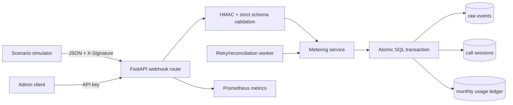

# Task 1 — Callzo Usage Metering Service

A signed-webhook usage metering backend built with Python, FastAPI, PostgreSQL, and explicit parameterized SQL. It handles duplicate and out-of-order delivery, integer-cent billing caps, late events, retries, and ledger reconciliation.

## System architecture



`main.py` owns HTTP routing, authentication, lifespan/background task setup, health and metrics endpoints. `schemas.py` validates incoming events and request payloads. `services.py` contains signature verification, idempotent event processing, call state transitions, cap policy, retry scheduling, and reconciliation. `database.py` defines the schema and explicit SQLite/PostgreSQL adapter. Each valid event is persisted in an immutable raw-event log and applied transactionally to call state and monthly aggregates. Monetary amounts are integers in cents to avoid floating point rounding.

## Repository structure

```text
task1-backend/
├── app/
│   ├── main.py          # FastAPI app, routes, auth, metrics, worker lifecycle
│   ├── schemas.py       # Pydantic validation for events and config updates
│   ├── database.py      # Schema, transactions, SQLite/PostgreSQL adapter
│   └── services.py      # Metering, caps, retries, reconciliation
├── tests/
│   └── test_metering.py # Unit and API behavior coverage with SQLite
├── Dockerfile           # Container image for the API
├── docker-compose.yml   # PostgreSQL, API, and scenario simulator
├── requirements.txt     # Python runtime and test dependencies
└── README.md            # Task-specific runbook
```

## Requirements and installation

Use Python 3.11+ for local development. Docker Desktop is required only for the full PostgreSQL + simulator stack. From this directory in PowerShell:

```powershell
py -3.12 -m venv .venv
.\.venv\Scripts\python.exe -m pip install --upgrade pip
.\.venv\Scripts\python.exe -m pip install -r requirements.txt
```

The app defaults to SQLite if `DATABASE_URL` is unset. Set explicit local development values and launch the API:

```powershell
$env:DATABASE_URL = 'sqlite:///./callzo_metering.db'
$env:WEBHOOK_SECRET = 'callzo_test_secret_change_me'
$env:ADMIN_API_KEY = 'callzo_admin_key_2026'
.\.venv\Scripts\python.exe -m uvicorn app.main:app --reload --host 127.0.0.1 --port 8000
```

Browse `http://localhost:8000/docs`, `/health`, and `/metrics`. Admin routes require `X-API-Key` or bearer authentication; the sample key above is for local assessment use only. Set `DEFAULT_MONTHLY_CAP_CENTS` and `LATE_EVENT_THRESHOLD_DAYS` to tune local behavior.

## Full stack with Docker Compose

From `task1-backend/`, start Docker Desktop and run:

```powershell
docker compose up --build
```

Compose starts PostgreSQL, waits for its health check, starts the API, waits for API health, then starts the ARM64 scenario simulator. The simulator exercises normal, duplicate, out-of-order, late, malformed, bad-signature, and cap-burst events. For x64 Docker Desktop hosts, Compose requests ARM64 emulation for this supplied image. Press `Ctrl+C` to stop. To run in the background use `docker compose up --build -d`, inspect with `docker compose ps` and `docker compose logs -f api simulator`, and stop with `docker compose down`.

If host ports `5432` or `8000` are occupied, choose free ports before starting Compose:

```powershell
$env:POSTGRES_HOST_PORT = '5433'
$env:API_HOST_PORT = '8002'
docker compose up --build
```

Only host-side ports change. Container-to-container connections still use PostgreSQL `5432` and API `8000`. For the example above, visit `http://localhost:8002/docs`.

## Unit tests

Tests run on SQLite and do not need Docker or PostgreSQL. From this folder:

```powershell
.\.venv\Scripts\python.exe -m pytest -q
```

Alternatively, `python -m unittest discover -s tests -v` is supported. Tests cover signature validation, input constraints, idempotency, lifecycle ordering, cap states, authentication, retry/backoff, and reconciliation. The suite sets its own `test_callzo_metering.db`; remove that generated file after a run if it remains in the working tree.

## API quick reference

Health and Prometheus metrics are public. Administrative examples use the default local key:

```powershell
$headers = @{ 'X-API-Key' = 'callzo_admin_key_2026' }
Invoke-RestMethod http://localhost:8000/health
Invoke-RestMethod -Headers $headers http://localhost:8000/api/v1/accounts
Invoke-RestMethod -Headers $headers http://localhost:8000/api/v1/accounts/acct_001/usage
Invoke-RestMethod -Method Post -Headers $headers http://localhost:8000/api/v1/reconcile
```

For detailed data model rationale and event scenario behavior, continue to the sections below.
