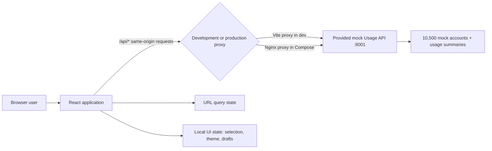

# Task 2 — Callzo Usage Admin Console

An account usage dashboard built with React 18 and Vite. It combines server-driven account management with an accessible, dimensional SVG usage visualization and an Apple-inspired liquid-glass interface.

## System architecture



In local development, Vite serves the SPA on port 3000 and proxies `/api` to `localhost:8001`. In Compose, the multi-stage Dockerfile builds the React bundle and Nginx serves it on port 3000; Nginx forwards `/api/*` to the `mock-api` service over the Compose network. The browser never needs to resolve a Docker-only service name. Account lists, summaries, and saved settings come from the API; filters, sorting, dates, and pagination are encoded in the URL; selected account IDs, theme, and unsaved edits are UI state.

## Repository structure

```text
task2-frontend/
├── src/
│   ├── App.jsx          # Dashboard, data requests, filters, chart, settings drawer
│   ├── index.css        # Liquid-glass styling, responsive and accessibility states
│   └── main.jsx         # React root and stylesheet entry
├── public/favicon.svg   # Custom Callzo glass C icon
├── index.html           # Document metadata and favicon link
├── vite.config.js        # Local server and API proxy
├── nginx.conf            # Production SPA fallback and API reverse proxy
├── Dockerfile            # Build stage + Nginx runtime
├── docker-compose.yml    # Local source build and mock API service
├── package.json          # npm scripts and dependency manifest
└── README.md             # Task-specific guide
```

## Requirements and installation

- Node.js 20 or newer with npm.
- Docker Desktop with the Linux engine for live mock data. The supplied mock API image is ARM64; Compose selects ARM64 so Docker Desktop can emulate it on x64 hosts.

From this directory:

```powershell
npm ci
```

Start the mock service in one terminal:

```powershell
docker compose up -d mock-api
Invoke-RestMethod http://localhost:8001/health
```

Start the frontend in another terminal:

```powershell
npm run dev
```

Visit `http://localhost:3000`. Vite forwards `/api/*` calls to `localhost:8001`. Stop the dev server with `Ctrl+C`; stop the API with `docker compose stop mock-api`.

## Full local Docker development

Compose builds the frontend from the current working tree, so source edits appear after rebuilding (the published frontend image is not used):

```powershell
docker compose up --build -d
docker compose ps
docker compose logs -f frontend mock-api
```

Open `http://localhost:3000`. Nginx serves the app and proxies API requests to `mock-api:8001` inside the Compose network. Stop and remove the local stack with `docker compose down`. Default host ports are `3000` and `8001`; change the port mappings in `docker-compose.yml` if either is occupied.

## Tests and build verification

There is currently no frontend unit-test framework or `test` script configured. Do not interpret a successful production build as a unit-test run. Check production compilation with:

```powershell
npm run build
```

Optionally preview the built assets with `npm run preview` at `http://localhost:3000`. When adding tests, add a runner and a documented npm test script to `package.json`.

## Features and interaction model

- Search, status/plan/country filters, sorting, page size, pagination, and date range are shareable through URL query parameters.
- Page selections are keyed by stable account IDs and persist through sorting, pagination, and refresh.
- Account rows refresh every 15 seconds; latest-request-wins behavior prevents stale requests from overwriting newer filters.
- The interactive 3D-style usage prism supports minutes, SMS, and spend, keyboard navigation, hover/focus selection, range aggregation, and explicit loading/error/empty/stale states.
- Account settings use a multi-step drawer with validation, autosave, keyboard focus management, Escape-to-close, and clear server feedback.
- Dark/light appearances, responsive layouts, reduced-motion, reduced-transparency, and higher-contrast preferences are supported.

## Design and implementation notes

The chart is native SVG rather than WebGL: facets and shadows create depth while preserving fast rendering and keyboard accessibility. The design uses layered translucent materials, restrained highlights, and purposeful interaction feedback. Filters and navigation live in the URL, API data remains server-owned, and drafts and selection are local UI state.
